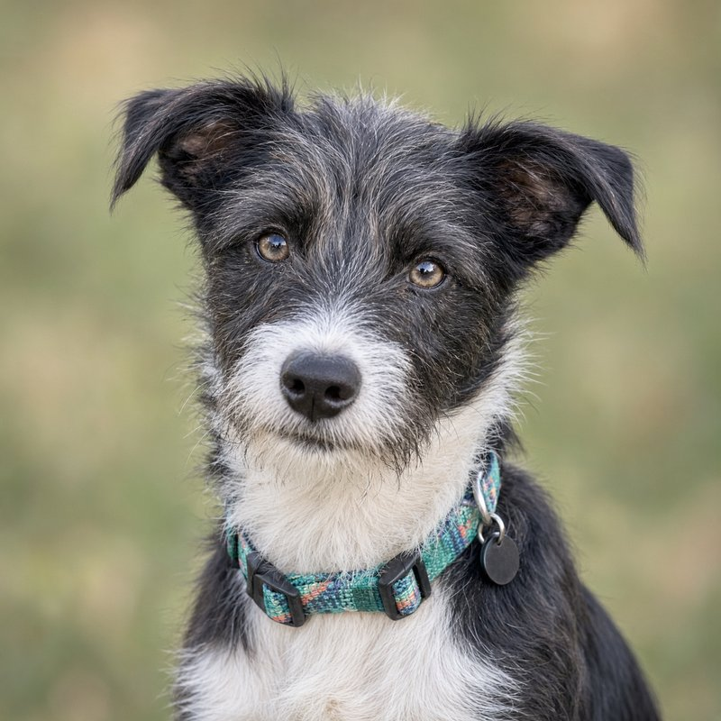

# bartguidry.com

The official website of Bart Guidry. Written by me, Bart. Typed by Gus, because I do not have thumbs.

## Who I am

I am a black-and-white schnoodle (allegedly) from Louisiana, adopted in October 2026 through [Dante's Hope](https://www.danteshope.com). I like cheese, walks, the purple ball, and being pet. I do not like baths, the hair dryer, cats, or the neighbors' reindeer.

My human is [Gus](https://gusguidry.com).

## Why this site exists

There is a QR code on my collar tag. If you scanned it, hello. You probably found me. Please check the "Did you find me?" section on the site and email Gus. I am microchipped, so any vet can scan me too.

## What's in here

| File | What it is |
| --- | --- |
| `index.html` | The whole site. One page, no frameworks. I keep things simple. |
| `bart.jpg` | My profile photo. Handsome. |
| `bart-qr.png`, `bart-qr.svg` | The QR code on my tag. Points to bartguidry.com. |
| `favicon.ico`, `favicon-32x32.png`, `apple-touch-icon.png`, `icon-512.png`, `site.webmanifest` | Icons, so I look good in your browser tab and on your home screen. |
| `CNAME` | Tells GitHub Pages my domain is bartguidry.com. Do not touch. |
| `.nojekyll` | Tells GitHub Pages to serve the files as they are. |

## How it's hosted

GitHub Pages serves the `main` branch as-is. The domain is registered at Porkbun and points here. Changes pushed to `main` go live in a minute or two.

## How to update it

1. Edit `index.html`.
2. Commit and push to `main`.
3. Wait a minute. Refresh.

Most updates are new weigh-ins for the growth log, new skills on the training report, and new opinions. I have a lot of opinions.

## Status

Current mood: good. README added. Stomach recovering.
